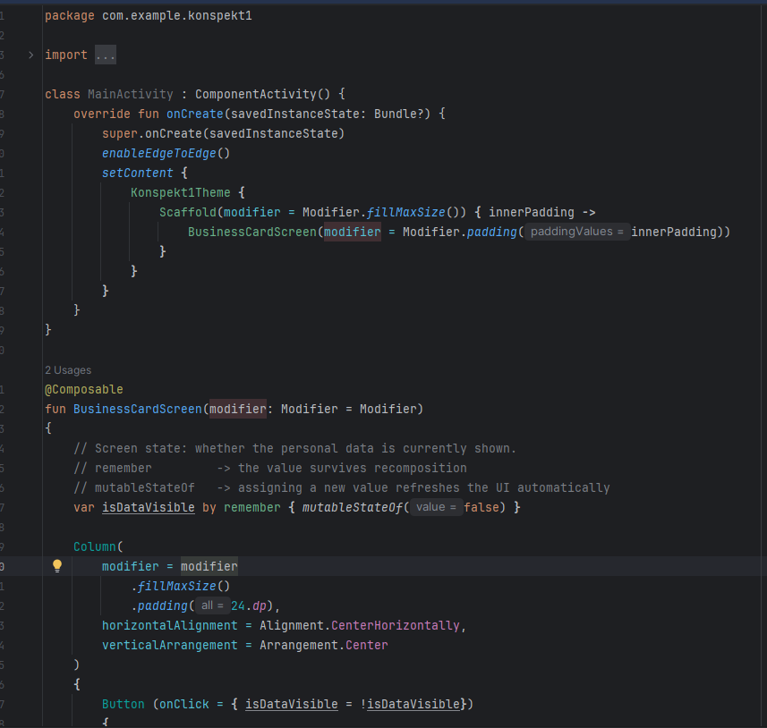
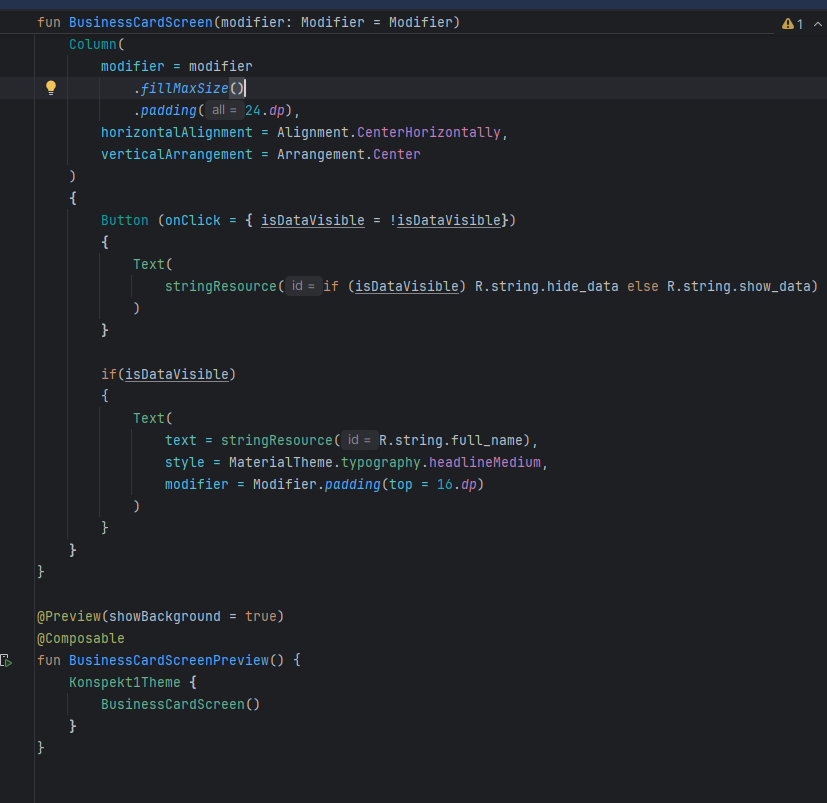
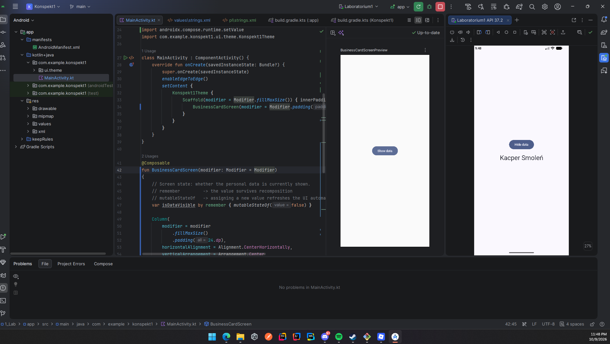
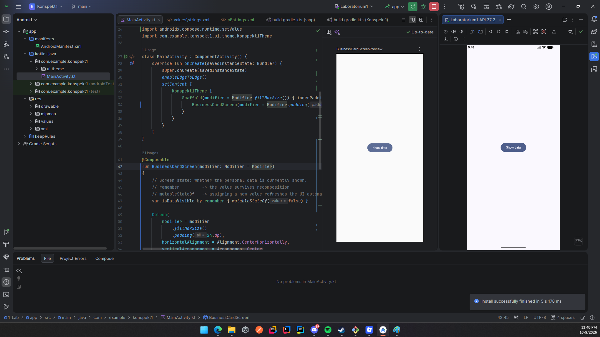
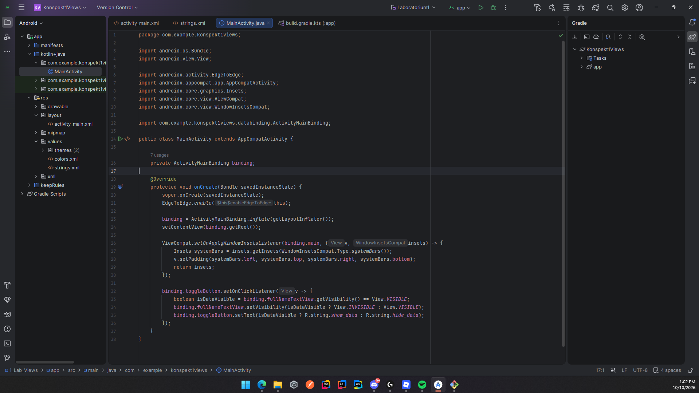
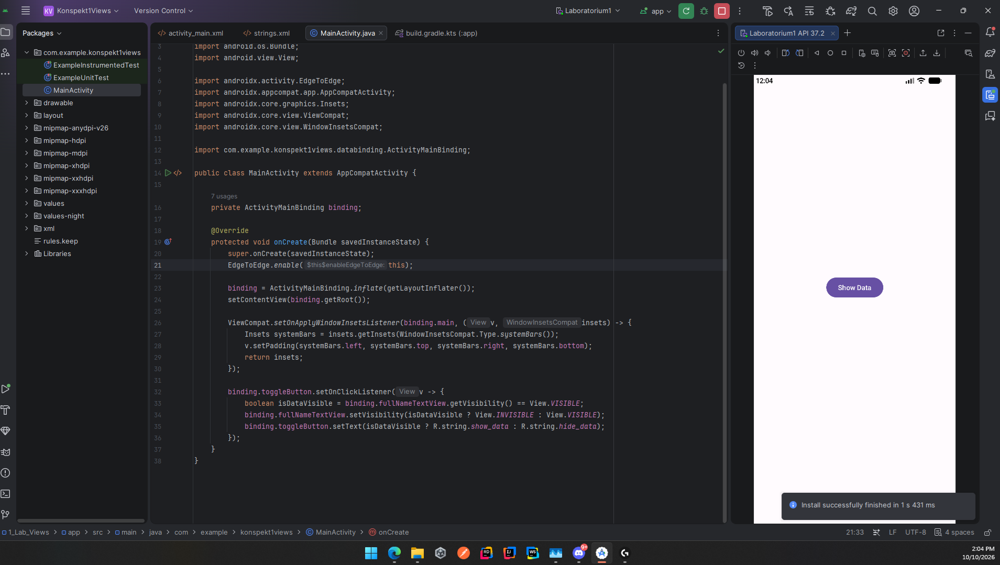
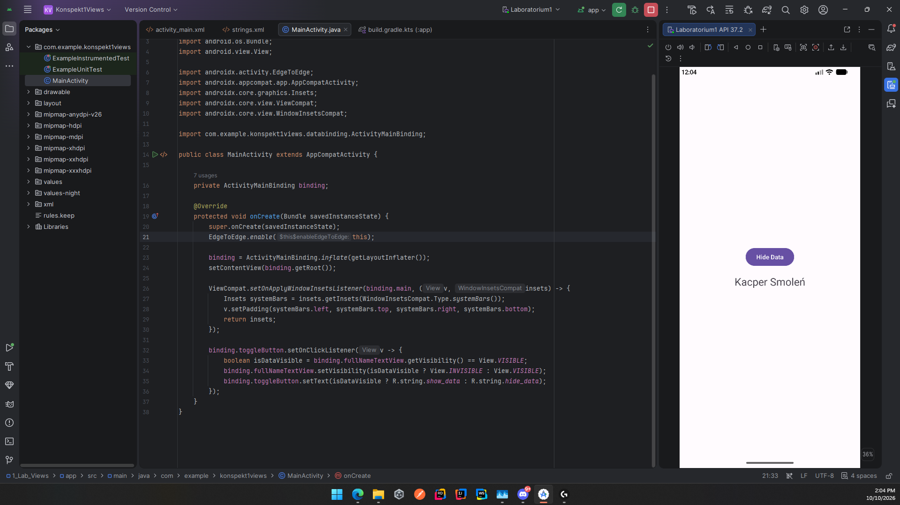

# Laboratorium 1: Wprowadzenie do Android Studio i interfejsu użytkownika

**Autor:** Kacper Smoleń  
**Przedmiot:** Programowanie Systemów Mobilnych  

## Cel ćwiczenia
Stworzenie prostej aplikacji wyświetlającej i ukrywającej dane osobowe za pomocą przycisku, wykorzystując dwa różne podejścia do budowy interfejsu w systemie Android: nowoczesne (Jetpack Compose z użyciem języka Kotlin) oraz klasyczne (Views z użyciem języka Java i układów XML).

## Zadanie 8: Porównanie podejść

Poniższa tabela przedstawia moje własne obserwacje z implementacji obu wariantów aplikacji.

### 1. Tabela porównawcza

| Zagadnienie | Jetpack Compose (Kotlin) | Views (Java + XML) |
| :--- | :--- | :--- |
| **Opis interfejsu** | Kod Kotlina, deklaratywne funkcje `@Composable`. | Oddzielny plik XML (wygląd) + kod aktywności w Javie (logika). |
| **Liczba edytowanych plików** | **2 pliki**  Główny kod w `MainActivity.kt` oraz teksty w `strings.xml`. | **4 pliki**  Konfiguracja ViewBinding w `build.gradle.kts`, układ w `activity_main.xml`, logika w `MainActivity.java` oraz teksty w `strings.xml`. |
| **Dostęp do kontrolek** | Niepotrzebny - stan (`isDataVisible`) automatycznie steruje widokiem. | View Binding (zastępujący dawne `findViewById`). |
| **Ukrywanie elementu** | Element po prostu nie powstaje (użycie warunku `if` w kodzie). | Manipulacja atrybutem `visibility` (zmiana na `invisible` / `gone`). |
| **Podgląd interfejsu** | Adnotacja `@Preview` odświeżająca się bezpośrednio w kodzie IDE. | Edytor wizualny układu XML (tryby Design / Split). |
| **Reakcja na zmianę danych** | Automatyczna rekompozycja wyzwalana zmianą stanu. | Ręczna aktualizacja właściwości kontrolek w kodzie. |
| **Czas kompilacji (obserwacje)** | Pierwsze budowanie trwało zauważalnie dłużej, jednak późniejsze odświeżanie podglądu `@Preview` przebiegało bardzo sprawnie. | Sama kompilacja projektu wydała się nieco szybsza, jednak ogólna praca bywała wolniejsza przez skakanie między plikami. |
| **Czytelność kodu (obserwacje)** | **Wysoka.** Cały wygląd i zachowanie przycisku oraz tekstu zamknięte są w spójnym i czytelnym bloku kodu. | **Średnia.** Logika (Java) i struktura (XML) są całkowicie odseparowane, co bywa uciążliwe przy prostych widokach. |

### 2. Wnioski 

Podejście **Jetpack Compose** okazało się dla mnie znacznie czytelniejsze. Pozwala ono na opisanie całego interfejsu i jego zachowania w jednym, spójnym miejscu (w pliku Kotlina). Eliminuje to konieczność ciągłego przełączania się między plikami XML a kodem logiki oraz ręcznego 'spinania' widoków z kodem, co znacząco ułatwia śledzenie i zarządzanie stanem aplikacji.

---

### 3. Zrzuty ekranu z działania aplikacji

#### Podejście A: Jetpack Compose (Kotlin)

**Podgląd struktury projektu i kodu:**

**Działanie w emulatorze:**
> *(Miejsce na screen: uruchomiona aplikacja - dane widoczne i ukryte)*

#### Podejście B: Views (Java + XML)

**Podgląd struktury projektu, kodu i XML:**

**Działanie w emulatorze:**

---
### 4. Uwagi z realizacji (Napotkane problemy)

W trakcie wykonywania laboratorium napotkałem na dodatkowe problemy konfiguracyjne środowiska Android Studio, co znacząco wydłużyło proces uruchomienia aplikacji:
1. **Emulator Systemu:** Po przystąpieniu do pracy kolejnego dnia emulator systemu nie chciał wstać i sypał błędami Terminated po czym wymagał operacji Wipe Data i Cold Boot